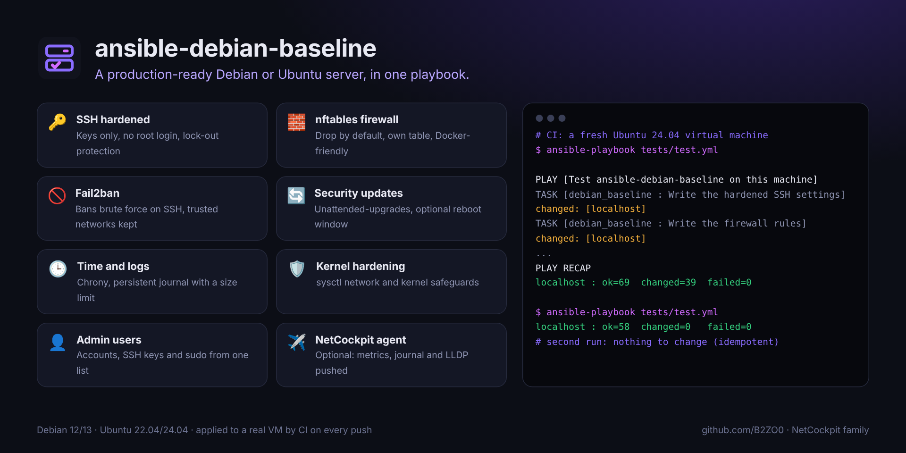

<div align="center">


# ansible-debian-baseline

### Un serveur Debian ou Ubuntu prêt pour la production, en un playbook.

**Sécurisation SSH, pare-feu, fail2ban, mises à jour de sécurité automatiques, heure, journaux et durcissement du noyau,<br>avec des valeurs sûres par défaut et un garde-fou qui ne t'enferme jamais dehors.**

[](https://github.com/B2ZO0/ansible-debian-baseline/actions/workflows/ci.yml)
[](LICENSE)


[English](README.md) · **Français**



</div>

---

## Pourquoi ?

Chaque nouveau serveur demande les mêmes vingt étapes avant d'être prêt : clés SSH, pas de connexion root, un pare-feu, fail2ban, les mises à jour de sécurité, le bon fuseau horaire… À la main, on en oublie toujours une. Ce rôle les fait toutes, de la même façon, à chaque fois, et peut être relancé sans risque : un deuxième passage ne change rien.

## ✨ Ce qu'il fait

| Domaine | Réglages |
|---|---|
| 🔑 **SSH** | Clés uniquement, connexion root refusée, 4 essais maximum, sessions inactives fermées, `AllowGroups` en option, bannière de connexion. La configuration est vérifiée avec `sshd -t` avant le rechargement. |
| 🧱 **Pare-feu** | nftables, entrant **bloqué par défaut**, SSH autorisé depuis les réseaux que tu choisis, règles supplémentaires dans une simple liste. Les règles sont dans **leur propre table** : Docker continue de fonctionner. |
| 🚫 **Fail2ban** | Prison SSH sur le journal systemd, bannissement via nftables, tes réseaux d'administration jamais bannis. |
| 🔄 **Mises à jour** | `unattended-upgrades` pour les correctifs de sécurité, redémarrage automatique en option à une heure fixe, rapport par mail en option. |
| 🕒 **Heure et journaux** | Fuseau horaire, chrony avec tes serveurs NTP, journal persistant avec une taille limite. |
| 🛡️ **Noyau** | Durcissement sysctl : pas de redirections ICMP ni de routage par la source, filtrage du chemin retour, SYN cookies, journaux et pointeurs du noyau protégés. |
| 👤 **Comptes admin** | Comptes, clés SSH et sudo (avec ou sans mot de passe) depuis une seule liste ; `state: absent` supprime un compte. |
| 📦 **Paquets** | Une base utile (curl, htop, jq, tmux, vim…), tes ajouts, et les clients non sécurisés comme telnet retirés. |
| ✈️ **Agent NetCockpit** | En option : Grafana Alloy et lldpd envoient les métriques, le journal systemd et les voisins LLDP/CDP à [NetCockpit](https://github.com/B2ZO0/netcockpit). |

### Il ne t'enferme pas dehors

Avant de couper la connexion par mot de passe, le rôle vérifie que quelqu'un pourra encore se connecter : un compte admin avec une clé SSH, ou une clé dans `~/.ssh/authorized_keys` du compte utilisé par Ansible. Sinon, il s'arrête avec un message clair au lieu de te couper l'accès. Il refuse aussi une liste vide de réseaux autorisés en SSH.

## 🚀 Démarrage rapide

```bash
# 1. Récupérer le rôle
ansible-galaxy role install git+https://github.com/B2ZO0/ansible-debian-baseline.git,main,debian_baseline

# 2. Copier les exemples et les adapter
curl -O https://raw.githubusercontent.com/B2ZO0/ansible-debian-baseline/main/examples/site.yml
curl -O https://raw.githubusercontent.com/B2ZO0/ansible-debian-baseline/main/examples/inventory.ini

# 3. Simulation, puis application
ansible-playbook -i inventory.ini site.yml --check --diff
ansible-playbook -i inventory.ini site.yml
```

Un playbook minimal :

```yaml
- name: Serveurs Debian prêts pour la production
  hosts: servers
  become: true
  vars:
    baseline_timezone: "Europe/Paris"
    baseline_admin_users:
      - name: enzo
        ssh_keys: ["ssh-ed25519 AAAA... enzo@portable"]
    baseline_firewall_ssh_sources: ["192.0.2.0/24"]   # ton réseau d'administration
    baseline_firewall_rules:
      - { port: 443, proto: tcp, comment: "HTTPS" }
  roles:
    - debian_baseline
```

Tu ne veux qu'une partie ? Chaque domaine a son tag : `--tags ssh,firewall` ou `--skip-tags updates`.

### Avant de le lancer

- **Restreins SSH** : par défaut, SSH est ouvert à tous (`0.0.0.0/0`). Renseigne `baseline_firewall_ssh_sources` avec tes réseaux d'administration.
- **L'agent NetCockpit envoie métriques et journaux en clair** (HTTP) vers ton hôte NetCockpit : garde ce trafic sur ton réseau interne.
- `sudo_nopasswd: true` est pratique pour l'automatisation, mais une clé SSH volée donne alors root : réserve-le aux comptes d'automatisation.

## ⚙️ Variables principales

Toutes les variables et leurs valeurs par défaut sont dans [`defaults/main.yml`](defaults/main.yml).

| Variable | Par défaut | Description |
|---|---|---|
| `baseline_timezone` | `Etc/UTC` | Fuseau horaire |
| `baseline_admin_users` | `[]` | `name`, `ssh_keys`, `sudo`, `sudo_nopasswd`, `state` |
| `baseline_ssh_port` | `22` | Port SSH (ouvert aussi dans le pare-feu) |
| `baseline_ssh_password_auth` | `false` | Autoriser la connexion par mot de passe |
| `baseline_ssh_permit_root_login` | `"no"` | `"no"` ou `"prohibit-password"` |
| `baseline_ssh_allow_groups` | `[]` | Seuls ces groupes peuvent se connecter |
| `baseline_firewall_enabled` | `true` | Gérer le pare-feu nftables |
| `baseline_firewall_ssh_sources` | tout le monde | Réseaux autorisés à joindre SSH |
| `baseline_firewall_rules` | `[]` | `{ port, proto, sources, comment }` |
| `baseline_fail2ban_enabled` | `true` | Installer et configurer fail2ban |
| `baseline_trusted_networks` | `[]` | Jamais bannis par fail2ban |
| `baseline_auto_updates` | `true` | Mises à jour de sécurité automatiques |
| `baseline_auto_reboot` | `false` | Redémarrer automatiquement si nécessaire |
| `baseline_ntp_servers` | pool Debian | Serveurs de temps |
| `baseline_netcockpit_server` | `""` | Hôte NetCockpit : installe l'agent quand il est renseigné |

## 🧪 Testé pour de vrai

À chaque modification, GitHub Actions applique le rôle **sur une vraie machine virtuelle Ubuntu 24.04**, vérifie le résultat (réglages SSH effectifs, règles du pare-feu, services démarrés), puis l'applique **une deuxième fois en exigeant zéro changement**. Le code est vérifié par `ansible-lint` (profil production) et `yamllint`.

> Changer le port SSH sur Ubuntu 24.04, où SSH est activé par socket, demande aussi une fois `systemctl daemon-reload && systemctl restart ssh.socket`.

## ✈️ De la famille NetCockpit

De petits outils ciblés pour les admins, du débutant au pro, par l'auteur de [**NetCockpit**](https://github.com/B2ZO0/netcockpit), le cockpit en direct de toute ton infrastructure.

| Outil | Ce qu'il fait |
|---|---|
| [NetCockpit](https://github.com/B2ZO0/netcockpit) | Topologie en direct, VMware, switchs, alertes et journaux dans un seul cockpit |
| [ad-audit-report](https://github.com/B2ZO0/ad-audit-report) | Bilan de santé de l'Active Directory sur une page HTML |
| [ansible-debian-baseline](https://github.com/B2ZO0/ansible-debian-baseline) | Ce rôle : un serveur Debian prêt pour la production |
| [netconfig-backup](https://github.com/B2ZO0/netconfig-backup) | Les configurations Cisco, FortiGate et UniFi versionnées dans Git |
| [sysadmin-toolbox](https://github.com/B2ZO0/sysadmin-toolbox) | Les outils PowerShell du quotidien pour les admins Windows |
| [proxmox-lab-terraform](https://github.com/B2ZO0/proxmox-lab-terraform) | Un lab de test complet sur Proxmox en une commande |

## 🤝 Contribuer

Une idée, un bug, un réglage qui manque ? [Ouvre un ticket](https://github.com/B2ZO0/ansible-debian-baseline/issues). Les pull requests sont les bienvenues.

Si ce rôle t'a fait gagner du temps, une ⭐ aide d'autres admins à le trouver.

---

<sub>Fait par [Enzo Marechal](https://enzomarechal.fr) ([@B2ZO0](https://github.com/B2ZO0)), administrateur système et réseau junior. Licence MIT.</sub>
