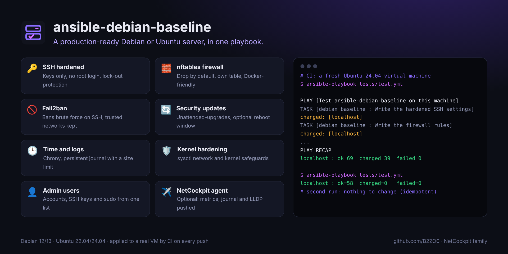

<div align="center">


# ansible-debian-baseline

### A production-ready Debian or Ubuntu server, in one playbook.

**SSH hardening, firewall, fail2ban, automatic security updates, time, logs and kernel hardening,<br>with safe defaults and a guard that never locks you out.**

[](https://github.com/B2ZO0/ansible-debian-baseline/actions/workflows/ci.yml)
[](LICENSE)


[](https://github.com/B2ZO0/ansible-debian-baseline/stargazers)

**English** · [Français](README.fr.md)



</div>

---

## Why?

Every new server needs the same twenty steps before it is ready: SSH keys, no root login, a firewall, fail2ban, security updates, the right time zone… Done by hand, one is always forgotten. This role does them all, the same way, every time, and can be run again safely: a second run changes nothing.

## ✨ What it does

| Area | Settings |
|---|---|
| 🔑 **SSH** | Keys only, root login refused, 4 attempts max, idle sessions closed, optional `AllowGroups`, login banner. The configuration is checked with `sshd -t` before reloading. |
| 🧱 **Firewall** | nftables, inbound **dropped by default**, SSH allowed from the networks you choose, extra rules from a simple list. Rules live in their **own table**, so Docker keeps working. |
| 🚫 **Fail2ban** | SSH jail on the systemd journal, ban through nftables, your admin networks never banned. |
| 🔄 **Updates** | `unattended-upgrades` for security updates, optional automatic reboot at a set time, optional mail report. |
| 🕒 **Time and logs** | Time zone, chrony with your NTP servers, persistent journal with a size limit. |
| 🛡️ **Kernel** | sysctl hardening: no ICMP redirects or source routing, reverse-path filter, SYN cookies, restricted kernel logs and pointers. |
| 👤 **Admin users** | Accounts, SSH keys and sudo (with or without password) from one list; `state: absent` removes a user. |
| 📦 **Packages** | A useful base set (curl, htop, jq, tmux, vim…), your extras, and insecure clients like telnet removed. |
| ✈️ **NetCockpit agent** | Optional: Grafana Alloy and lldpd push metrics, the systemd journal and LLDP/CDP neighbours to [NetCockpit](https://github.com/B2ZO0/netcockpit). |

### It will not lock you out

Before disabling password login, the role checks that someone can still connect: an admin user with an SSH key, or a key in `~/.ssh/authorized_keys` of the account Ansible connects with. If there is none, it stops with a clear message instead of cutting you off. It also refuses an empty list of SSH source networks.

## 🚀 Quick start

```bash
# 1. Get the role
ansible-galaxy role install git+https://github.com/B2ZO0/ansible-debian-baseline.git,main,debian_baseline

# 2. Copy the examples and edit them
curl -O https://raw.githubusercontent.com/B2ZO0/ansible-debian-baseline/main/examples/site.yml
curl -O https://raw.githubusercontent.com/B2ZO0/ansible-debian-baseline/main/examples/inventory.ini

# 3. Dry run, then apply
ansible-playbook -i inventory.ini site.yml --check --diff
ansible-playbook -i inventory.ini site.yml
```

A minimal playbook:

```yaml
- name: Production-ready Debian servers
  hosts: servers
  become: true
  vars:
    baseline_timezone: "Europe/Paris"
    baseline_admin_users:
      - name: enzo
        ssh_keys: ["ssh-ed25519 AAAA... enzo@laptop"]
    baseline_firewall_ssh_sources: ["192.0.2.0/24"]   # your admin network
    baseline_firewall_rules:
      - { port: 443, proto: tcp, comment: "HTTPS" }
  roles:
    - debian_baseline
```

Only want part of it? Every area has a tag: `--tags ssh,firewall` or `--skip-tags updates`.

### Before you run it

- **Restrict SSH**: the default allows SSH from everywhere (`0.0.0.0/0`). Set `baseline_firewall_ssh_sources` to your admin networks.
- **The NetCockpit agent sends metrics and logs in clear text** (HTTP) to your NetCockpit host: keep that traffic on your internal network.
- `sudo_nopasswd: true` is convenient for automation, but a stolen SSH key then gives root: keep it for dedicated automation accounts.

## ⚙️ Main variables

All variables and their defaults are in [`defaults/main.yml`](defaults/main.yml).

| Variable | Default | Description |
|---|---|---|
| `baseline_timezone` | `Etc/UTC` | Time zone |
| `baseline_admin_users` | `[]` | `name`, `ssh_keys`, `sudo`, `sudo_nopasswd`, `state` |
| `baseline_ssh_port` | `22` | SSH port (also opened in the firewall) |
| `baseline_ssh_password_auth` | `false` | Allow password login |
| `baseline_ssh_permit_root_login` | `"no"` | `"no"` or `"prohibit-password"` |
| `baseline_ssh_allow_groups` | `[]` | Only these groups may log in |
| `baseline_firewall_enabled` | `true` | Manage the nftables firewall |
| `baseline_firewall_ssh_sources` | everyone | Networks allowed to reach SSH |
| `baseline_firewall_rules` | `[]` | `{ port, proto, sources, comment }` |
| `baseline_fail2ban_enabled` | `true` | Install and configure fail2ban |
| `baseline_trusted_networks` | `[]` | Never banned by fail2ban |
| `baseline_auto_updates` | `true` | Automatic security updates |
| `baseline_auto_reboot` | `false` | Reboot automatically when needed |
| `baseline_ntp_servers` | Debian pool | Time servers |
| `baseline_netcockpit_server` | `""` | NetCockpit host: installs the agent when set |

## 🧪 Tested for real

On every push, GitHub Actions applies the role **to a real Ubuntu 24.04 virtual machine**, checks the result (effective SSH settings, firewall rules, running services), then applies it **a second time and requires zero changes**. Lint runs with `ansible-lint` (production profile) and `yamllint`.

> Changing the SSH port on Ubuntu 24.04, where SSH is socket-activated, also needs `systemctl daemon-reload && systemctl restart ssh.socket` once.

## ✈️ Part of the NetCockpit family

Small, focused tools for sysadmins, from beginners to pros, by the author of [**NetCockpit**](https://github.com/B2ZO0/netcockpit), a live cockpit for your whole infrastructure.

| Tool | What it does |
|---|---|
| [NetCockpit](https://github.com/B2ZO0/netcockpit) | Live topology, VMware, switches, alerts and logs in one cockpit |
| [ad-audit-report](https://github.com/B2ZO0/ad-audit-report) | Active Directory health check in one HTML page |
| [ansible-debian-baseline](https://github.com/B2ZO0/ansible-debian-baseline) | This role: a production-ready Debian server |
| [netconfig-backup](https://github.com/B2ZO0/netconfig-backup) | Cisco, FortiGate and UniFi configs, versioned in Git |
| [sysadmin-toolbox](https://github.com/B2ZO0/sysadmin-toolbox) | Everyday PowerShell tools for Windows admins |
| [proxmox-lab-terraform](https://github.com/B2ZO0/proxmox-lab-terraform) | A complete test lab on Proxmox in one command |

## 🤝 Contributing

Ideas, bugs, a setting you miss? [Open an issue](https://github.com/B2ZO0/ansible-debian-baseline/issues). Pull requests are welcome.

If this role saved you some time, a ⭐ helps other admins find it.

---

<sub>Made by [Enzo Marechal](https://enzomarechal.fr) ([@B2ZO0](https://github.com/B2ZO0)), junior system and network administrator. MIT license.</sub>
